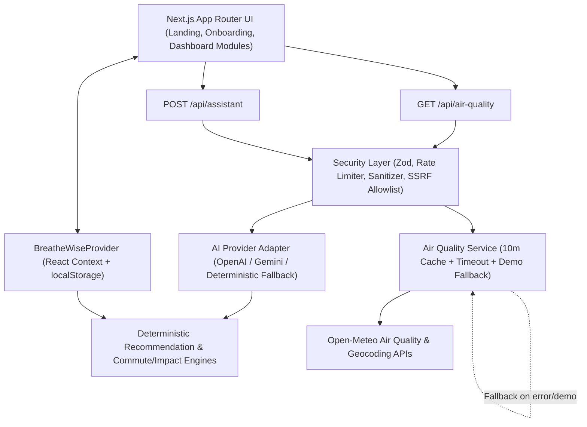
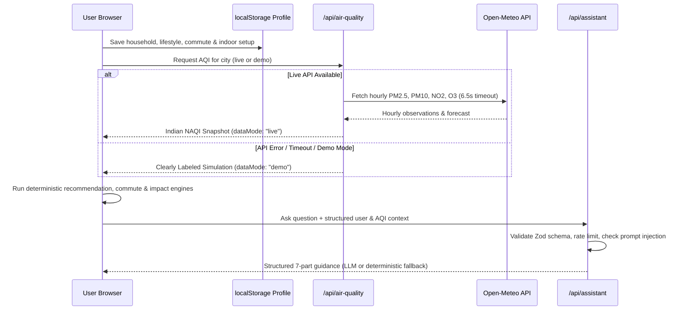

# BreatheWise AI — Urban Air Quality Decision Assistant

> **Challenge 6: Urban Air Quality Assistant | PromptWars**  
> *"Don't just tell people how polluted their city is. Tell them what they should do differently today, why it matters, and what impact their decisions create."*

---

## 1. Problem Statement & Why BreatheWise AI Exists

Urban populations face severe winter smog episodes and recurring particulate pollution driven by thermal inversions, traffic corridors, construction dust, and household combustion. Generic AQI widgets only report a static city number—leaving families unsure whether children can play outdoors, when to open windows, whether cycling is healthier than taking the metro, or what low-cost indoor actions actually work.

**BreatheWise AI** transforms raw pollutant data into personalized, context-aware daily decisions, indoor air hygiene, smarter commute trade-offs, and transparent sustainability impact tracking.

## 2. Target Personas

Personalization changes actual recommendation rankings, timing windows, commute comparisons, and indoor checklists across all five personas:

1. **Working professionals commuting daily** — commute-mode exposure vs emissions trade-offs, traffic recirculation, and errand bundling.
2. **Families with children** — school transit protection, evening playground substitutions, and kitchen exhaust habits.
3. **Students attending schools and colleges** — low-cost mask/route guidance and campus transit timing.
4. **Senior citizens** — indoor particulate stability, morning walk delays, and damp-cleaning routines.
5. **Outdoor workers and fitness enthusiasts** — high-ventilation exercise shifts, midday dispersion windows, and fitted N95/FFP2 protection.

## 3. Core Features

- **Polished Product Landing Page (`/`)**: Interactive city decision preview, problem awareness, feature overview, 4-step workflow, and transparent impact summary.
- **6-Step Personalized Onboarding (`/onboarding`)**: Zod-validated multi-step wizard collecting city/locality, household, lifestyle, commute mode & distance, indoor environment, and budget preferences—saved locally in `localStorage`.
- **Personalized Command Center (`/dashboard`)**:
  - Indian NAQI (CPCB) overview with PM2.5, PM10, dominant pollutant, data source, timestamp, and non-color-only category badges.
  - Transparent Lifestyle Exposure Sensitivity Indicator (explicitly labeled non-medical).
  - Prioritized context-aware recommendations with *What, Why, When, Benefit, Difficulty, Cost, Impact, and Supporting Data*.
  - 24-hour trajectory chart clearly separating **Observed**, **Forecast**, and **Simulated Demo** data points.
  - Morning / Afternoon / Evening / Night daily plan and interactive Household Safety Checklist.
- **BreatheWise Intelligence AI Assistant (`/api/assistant`)**: Context-grounded conversational assistant with configurable server-side LLM (`openai` or `gemini`) and a full deterministic fallback when no API key is configured.
- **Dedicated Modules**:
  - **Air Quality Intelligence (`/dashboard/air-quality`)**: Pollutant breakdown, CPCB scale reference, city switcher, and Good/Moderate/Poor/Severe simulation controls.
  - **Indoor Air Intelligence (`/dashboard/indoor-air`)**: Timed ventilation windows, cooking fuel guidance, HEPA maintenance, low-cost alternatives (explicitly noting houseplants alone cannot purify a room), and room-wise checklists.
  - **Smart Commute Assistant (`/dashboard/commute`)**: Compares Walking, Cycling, Public Transit, Car, and Two-Wheeler on travel time, modeled exposure, and CO2 emissions—explicitly warning that shorter arterial routes do not mean lower exposure.
  - **Sustainable Alternatives (`/dashboard/sustainability`)**: Practical low-emission habits with personal and environmental benefits.
  - **Impact Tracker (`/dashboard/impact`)**: Weekly/monthly self-tracked CO2 savings, action streaks, and transparent formulas/baselines.
  - **Community Intelligence (`/dashboard/community`)**: City winter smog context, neighborhood challenges, and privacy-preserving shareable advisory cards.

## 4. Application & System Architecture



### Data Flow Diagram



## 5. Recommendation Engine & AQI Methodology

### Indian NAQI (CPCB) Calculation (`src/lib/aqi.ts`)
- Computes linear sub-indices across CPCB breakpoints for **PM2.5** (0–30 Good, 31–60 Satisfactory, 61–90 Moderate, 91–120 Poor, 121–250 Very Poor, 250+ Severe), **PM10**, **NO2**, and **O3**.
- Selects the maximum sub-index as the overall AQI and identifies the dominant pollutant.
- *Assumption*: Open-Meteo provides hourly concentration grids; BreatheWise treats the nearest-hour reading as the instantaneous proxy rather than a 24-hour rolling filter average, and labels this clearly alongside the data source.

### Deterministic Recommendation Engine (`src/lib/recommendation-engine.ts`)
Evaluates current AQI, household vulnerability (`family_with_children`, `household_with_seniors`), lifestyle (`fitness_enthusiast`, `outdoor_worker`, `remote_worker`, `student`, `office_commuter`), commute mode & distance, indoor equipment (`hasAirPurifier`, `cookingFuel`, `windowsFrequentlyOpen`), and budget preference (`zero_low_cost`, `moderate`, `flexible`). Scores and sorts recommendations by risk urgency and personal relevance.

### Environmental Impact Methodology (`src/lib/commute-impact.ts`)
- **Transport CO2 baselines**: Solo petrol car `0.171 kg CO2/passenger-km`, two-wheeler `0.072 kg CO2/km`, urban public transit (bus/metro blended) `0.041 kg CO2/passenger-km`, walking/cycling/WFH `0 kg CO2/km`.
- **Checklist actions**: Conservative self-tracking estimates (`0.10–0.65 kg CO2/action`).
- All estimates are explicitly labeled educational baselines and **not** audited or verified carbon offsets.

## 6. Live Mode vs Demonstration Mode

| Mode | Trigger | Data Source | Hourly Labels |
|---|---|---|---|
| **Live Mode** | Default when online | Open-Meteo Air Quality & Geocoding APIs | `observed` (past/current) & `forecast` (future) |
| **Demonstration Mode** | User toggle, scenario button, or automatic upstream failure fallback | `buildDemoAirQualitySnapshot` diurnal curve (`good`, `moderate`, `poor`, `severe`) | `simulated` (clearly badged in UI banner) |

Live measurements are never fabricated or silently replaced; any fallback displays an explicit **Demonstration Mode Active** banner.

## 7. Security & Privacy Architecture

- See [SECURITY.md](file:///c:/Users/Administrator/OneDrive/Desktop/Ch6/SECURITY.md), [THREAT_MODEL.md](file:///c:/Users/Administrator/OneDrive/Desktop/Ch6/security/THREAT_MODEL.md), [DATA_PRIVACY.md](file:///c:/Users/Administrator/OneDrive/Desktop/Ch6/security/DATA_PRIVACY.md), [SECURITY_CHECKLIST.md](file:///c:/Users/Administrator/OneDrive/Desktop/Ch6/security/SECURITY_CHECKLIST.md), and [SECURITY_TESTS.md](file:///c:/Users/Administrator/OneDrive/Desktop/Ch6/security/SECURITY_TESTS.md).
- **Prototype Scope**: No user authentication or server database exists; all profile preferences reside in browser `localStorage` and can be cleared in Settings.
- **Rate Limiting**: Upstash Redis REST adapter when configured, falling back to a single-instance token bucket (explicitly documented as non-distributed across multiple serverless instances).

## 8. Performance & Accessibility

- Performance details are documented in [PERFORMANCE.md](file:///c:/Users/Administrator/OneDrive/Desktop/Ch6/PERFORMANCE.md): dynamic imports for Recharts, 10-minute server caching with in-flight deduplication, and minimal client state.
- **Accessibility (WCAG 2.2 AA practices)**: Semantic landmarks, skip link, keyboard-operable controls, `aria-checked` switches/checkboxes, `role="alert"` validation errors, non-color-only AQI badges (always paired with category text + icon + range), chart text summaries, and `MotionConfig reducedMotion="user"`.

## 9. Project Directory Structure

```text
src/
  app/
    api/
      air-quality/route.ts    # Validated, cached AQI proxy + demo fallback
      assistant/route.ts      # Rate-limited, sanitized AI guidance endpoint
      health/route.ts         # Service readiness endpoint
    dashboard/                # Overview + 8 specialized module routes
    onboarding/page.tsx       # 6-step onboarding flow
    page.tsx                  # Product landing page
  components/                 # Modular UI, charts, assistant, shell, and module views
  lib/
    security/                 # Env validation, rate limiter, sanitization
    ai-assistant.ts           # OpenAI/Gemini adapter + deterministic fallback
    air-quality-service.ts    # Open-Meteo integration + caching + demo curves
    aqi.ts                    # CPCB Indian NAQI calculation engine
    cities.ts                 # Indian city presets & winter notes
    commute-impact.ts         # Commute comparator & transparent CO2 formulas
    recommendation-engine.ts  # Context-aware rules engine & daily slot planner
    schemas.ts                # Shared Zod validation schemas
    storage.ts                # localStorage persistence helpers
tests/
  unit/                       # Vitest unit tests
  integration/                # API route & service integration tests
  e2e/                        # Playwright desktop + mobile end-to-end tests
  fixtures/ & mocks/          # Good/Moderate/Poor/Severe fixtures & API mocks
security/                     # Threat model, privacy, checklist, security test map
```

## 10. Documentation Suite & CI Quality Gates

- **Audit & Evaluation**: [EVALUATION_RESEARCH.md](file:///c:/Users/Administrator/OneDrive/Desktop/Ch6/docs/EVALUATION_RESEARCH.md) • [PROJECT_AUDIT.md](file:///c:/Users/Administrator/OneDrive/Desktop/Ch6/PROJECT_AUDIT.md) • [FINAL_EVALUATION_REPORT.md](file:///c:/Users/Administrator/OneDrive/Desktop/Ch6/docs/FINAL_EVALUATION_REPORT.md)
- **Alignment**: [PROBLEM_STATEMENT_ALIGNMENT.md](file:///c:/Users/Administrator/OneDrive/Desktop/Ch6/docs/PROBLEM_STATEMENT_ALIGNMENT.md) • [FEATURE_TRACEABILITY.md](file:///c:/Users/Administrator/OneDrive/Desktop/Ch6/docs/FEATURE_TRACEABILITY.md) • [SOLUTION_OVERVIEW.md](file:///c:/Users/Administrator/OneDrive/Desktop/Ch6/docs/SOLUTION_OVERVIEW.md)
- **Engineering**: [ARCHITECTURE.md](file:///c:/Users/Administrator/OneDrive/Desktop/Ch6/docs/ARCHITECTURE.md) • [API_DOCUMENTATION.md](file:///c:/Users/Administrator/OneDrive/Desktop/Ch6/docs/API_DOCUMENTATION.md) • [CODE_QUALITY.md](file:///c:/Users/Administrator/OneDrive/Desktop/Ch6/docs/CODE_QUALITY.md) • [DECISIONS.md](file:///c:/Users/Administrator/OneDrive/Desktop/Ch6/docs/DECISIONS.md)
- **Security, Testing, A11y, Perf**: [docs/SECURITY.md](file:///c:/Users/Administrator/OneDrive/Desktop/Ch6/docs/SECURITY.md) • [TESTING.md](file:///c:/Users/Administrator/OneDrive/Desktop/Ch6/docs/TESTING.md) • [TEST_COVERAGE.md](file:///c:/Users/Administrator/OneDrive/Desktop/Ch6/docs/TEST_COVERAGE.md) • [ACCESSIBILITY_AUDIT.md](file:///c:/Users/Administrator/OneDrive/Desktop/Ch6/docs/ACCESSIBILITY_AUDIT.md) • [PERFORMANCE_AUDIT.md](file:///c:/Users/Administrator/OneDrive/Desktop/Ch6/docs/PERFORMANCE_AUDIT.md)
- **Operations**: [DEVELOPMENT.md](file:///c:/Users/Administrator/OneDrive/Desktop/Ch6/docs/DEVELOPMENT.md) • [ENVIRONMENT_SETUP.md](file:///c:/Users/Administrator/OneDrive/Desktop/Ch6/docs/ENVIRONMENT_SETUP.md) • [DEPLOYMENT.md](file:///c:/Users/Administrator/OneDrive/Desktop/Ch6/docs/DEPLOYMENT.md) • [CONTRIBUTING.md](file:///c:/Users/Administrator/OneDrive/Desktop/Ch6/docs/CONTRIBUTING.md) • [CHANGELOG.md](file:///c:/Users/Administrator/OneDrive/Desktop/Ch6/docs/CHANGELOG.md) • [KNOWN_LIMITATIONS.md](file:///c:/Users/Administrator/OneDrive/Desktop/Ch6/docs/KNOWN_LIMITATIONS.md)

## 11. Installation, Development & Verification

```bash
# 1. Install dependencies
npm install

# 2. Configure optional environment variables (works out of the box with no API keys)
cp .env.example .env.local

# 3. Run local development server
npm run dev

# 4. Quality & Test Commands
npm run typecheck
npm run lint
npm run format:check
npm run test:coverage
npm run audit
npm run build
npm run test:e2e
npm run test:a11y
```

## 12. Known Limitations & Future Improvements

- **Known Limitations**:
  - Open-Meteo provides model-assimilated atmospheric estimates (~11–40 km grid) rather than hyperlocal street-corner monitors.
  - Without `UPSTASH_REDIS_REST_URL`, API rate limiting is single-instance in-memory.
  - Preferences are stored locally in the browser (no multi-device account sync).
- **Future Improvements**:
  - Integrate official CPCB / state pollution control board station feeds where open APIs permit.
  - Optional PWA push notifications for morning smog alerts and school-window reminders.
  - Localized regional language support (Bengali, Hindi, Tamil, Marathi, Kannada).

## 13. Responsible AI & Health Disclaimer

BreatheWise AI provides educational air-quality planning and environmental estimation only. It does **not** provide medical diagnoses, clinical risk scores, or guaranteed protection against air pollution. Always seek qualified medical advice for respiratory or cardiovascular symptoms.

