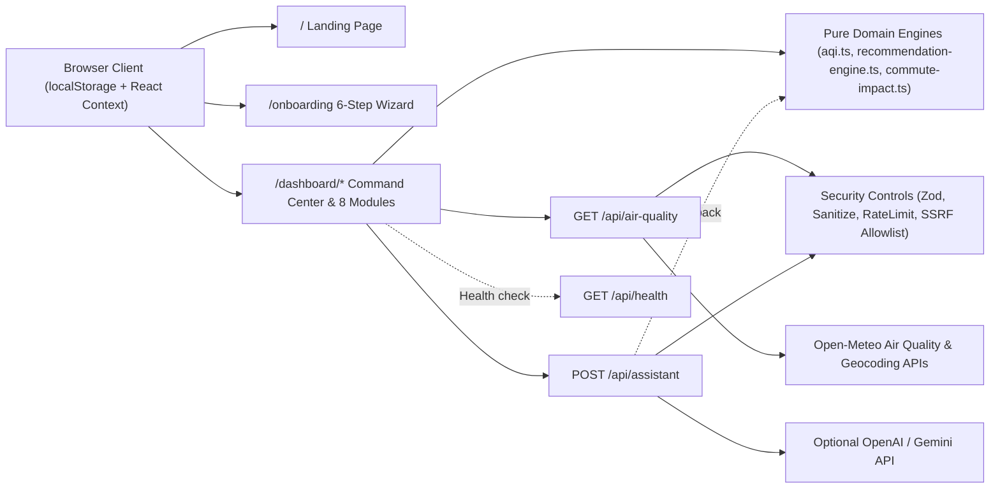

# System Architecture — BreatheWise AI

## Architectural Principles
BreatheWise AI uses a layered Next.js App Router architecture with strict separation between:
1. **Presentation Layer (`src/app/`, `src/components/`)**: Responsive UI routes, accessible primitives, and client context (`BreatheWiseProvider`).
2. **API Boundary Layer (`src/app/api/`)**: Input-validated, rate-limited route handlers enforcing payload limits and error redaction.
3. **Domain & Intelligence Layer (`src/lib/`)**: Pure TypeScript engines for Indian NAQI calculation, personalized recommendations, commute trade-offs, and transparent impact accounting.
4. **External Adapter Layer (`src/lib/air-quality-service.ts`, `src/lib/ai-assistant.ts`)**: Timeout-guarded, SSRF-allowlisted connectors to Open-Meteo and optional LLM providers with deterministic fallbacks.

## Component & Data Flow Diagram

## Module Responsibilities

| Module | Responsibility | Key Exports |
|---|---|---|
| `src/lib/aqi.ts` | Indian CPCB NAQI sub-index math & severity metadata | `calculateIndianAqi`, `getAqiCategory`, `AQI_CATEGORY_META` |
| `src/lib/recommendation-engine.ts` | Persona, indoor, commute & budget rule prioritization | `generateRecommendations`, `computeExposureIndicator`, `generateDailySlotPlan`, `buildDefaultChecklist` |
| `src/lib/commute-impact.ts` | Commute option modeling & transparent CO2 formulas | `compareCommuteOptions`, `calculateImpactMetrics` |
| `src/lib/air-quality-service.ts` | Open-Meteo fetch, 10m bounded cache, demo mode builder | `getAirQualitySnapshot`, `buildDemoAirQualitySnapshot` |
| `src/lib/ai-assistant.ts` | Configurable OpenAI/Gemini adapter + deterministic engine | `generateAssistantGuidance`, `buildDeterministicAssistantResponse` |
| `src/lib/schemas.ts` | Shared Zod schemas for forms, APIs, and AI responses | `userProfileSchema`, `assistantRequestSchema`, `airQualityQuerySchema` |
| `src/lib/security/*` | Env validation, rate limiting, prompt/XSS sanitization | `getServerEnv`, `isAllowedExternalUrl`, `checkRateLimit`, `detectPromptInjection` |
